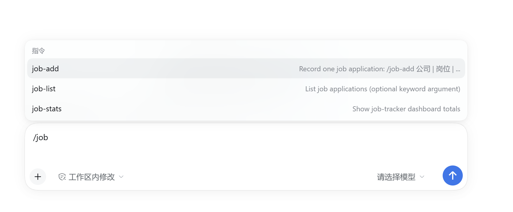

# dsh-job-tracker

[DeepSeek Harness](https://github.com/deepseek-ai/deepseek-harness)（DSH）插件：把本机运行的 [job-tracker](https://github.com/Suqs259/job-tracker)（校招投递管理台，Flask + SQLite）接进 DSH——**在聊天里说一句话就能记录投递，一条命令就能看投递统计**。



`/job-stats` 实际运行效果（演示数据）：


## 它提供什么

| 形态 | 名称 | 用途 |
|---|---|---|
| 斜杠命令 | `/job-stats` | 投递总览：总量、笔面转化率、Offer 率、阶段分布、渠道分布、近 30 天趋势 |
| 斜杠命令 | `/job-list [关键词]` | 列出最近 20 条记录，可按公司 / 岗位 / 备注筛选 |
| 斜杠命令 | `/job-add 公司 \| 岗位 \| ...` | 快速录入一条投递（见下方「参数传递说明」） |
| 模型工具 | `job_tracker` | DSH 的模型可直接调用：自然语言即可增查改 |

日常最顺手的是**直接说话**，模型会替你调 `job_tracker` 工具：

```
记一下，今天投了视源股份的数据开发岗，官网投的，14-18K
→ 模型调用 job_tracker(action="add", company="视源股份", ...)

我这个月投了多少家？哪个渠道面试多？
→ 模型调用 job_tracker(action="stats") 并给出解读
```

## 前置条件

1. [job-tracker](https://github.com/Suqs259/job-tracker) 已在本机运行（`python run.py`，默认 `http://127.0.0.1:5000`）
2. 已在 job-tracker 注册过账号（首次访问网页时创建）
3. DeepSeek Harness ≥ 0.2.1

## 安装

### 命令行 profile（`dsh web` 等）

```bash
git clone https://github.com/Suqs259/dsh-job-tracker.git
dsh plugin --profile web add file:/绝对路径/dsh-job-tracker
```

> 尚未发布到 npm。等发布后可直接 `dsh plugin --profile web add dsh-job-tracker`。

npx 用户注意：`@deepseek-ai/dsh` 的版本号是预发布号，`npx -y @deepseek-ai/dsh` 会因 `*` 匹配不到而失败，需显式指定版本：

```bash
npx -y @deepseek-ai/dsh@0.2.2-rc.1 plugin --profile web add file:/绝对路径/dsh-job-tracker
```

### 桌面版（Electron）

桌面版 profile 由应用独占管理，CLI 会直接拒绝：

```
error: profile "desktop" is managed exclusively by the Electron application
```

两条可行路径：

1. **推荐**：在 DSH 设置里的插件管理处，从本地路径安装 `dsh-job-tracker` 所在目录
2. **手工注入**（本文实测方式）——编辑 `~/.dsh/profiles/desktop/`：

```jsonc
// package.json：加依赖 + 注册 bundle
{
  "dependencies": { "dsh-job-tracker": "file:D:/path/to/dsh-job-tracker" },
  "dsh": { "profile": { "bundles": [ /* ...原有项, */ "dsh-job-tracker" ] } }
}
```

```bash
# 用 DSH 自带运行时安装（拖动 node_modules 后勿与其他插件并发写）
node <runtime>/dependencies/node/bin/node.exe \
     <runtime>/dependencies/pnpm/bin/pnpm.cjs install
```

然后在 `cordis.patch.yml` 末尾补配置段（桌面版从 GUI 启动，没有环境变量通道，只能写在这里）：

```yaml
- id: job-tracker
  name: 'dsh-job-tracker'
  config:
    baseUrl: 'http://127.0.0.1:5000'
    username: '你的账号'
    password: '你的密码'
```

改完重启桌面版。**改动前先备份 `package.json`、`pnpm-lock.yaml`、`cordis.patch.yml`**，出问题直接覆盖回滚。

## 配置

DSH 进程启动前设置三个环境变量（`config` 覆盖时以 `config` 为准）：

| 变量 | 默认值 | 说明 |
|---|---|---|
| `DSH_JOB_TRACKER_URL` | `http://127.0.0.1:5000` | job-tracker 地址 |
| `DSH_JOB_TRACKER_USERNAME` | 无，必填 | 登录用户名 |
| `DSH_JOB_TRACKER_PASSWORD` | 无，必填 | 登录密码 |

凭证只经环境变量传入、只存在进程内存里；插件源码不含任何密钥。

登录方式是 job-tracker 的会话登录（密码哈希校验，`HttpOnly` Cookie）。会话过期时插件自动重登一次再重试，长驻的 dsh 进程不需要重启。

## 参数传递说明（重要）

部分 DSH 版本的 Web/桌面客户端在「点选命令后补参数」的路径上会丢失参数（草稿中的命令 token 被清空、参数变成普通消息）。经实测：

- `/job-stats`、`/job-list`（不带参数）在 0.2.2-rc.1 与 0.2.1-rc.2 下均正常
- **录入记录请优先用自然语言**（模型调用 `job_tracker` 工具，参数是结构化 JSON，不受该问题影响）
- `/job-add` 在你的客户端版本上如果只回用法提示、不认参数，就是踩到了上述问题——用自然语言即可，功能不缺

## 实现要点

- **零构建**：纯 ESM JavaScript，没有 TypeScript 编译链。`package.json` 声明 `dsh.bundle.patch` 指向 `cordis.patch.yml`，一行把插件挂进 profile
- **两条注册路径**：命令走 `ctx.commands.register`（每个注册放在 `ctx.effect` 生成器中，teardown 按 LIFO 回收）；工具走 `ctx.tools.register(defineTool(...))`
- **连接管理**：每个 dsh 进程持有一个会话 Cookie，401 时自动重登一次；所有错误转换为可读的中文提示（连接失败会提示「服务是否已启动」）
- **输出即人读**：统计在 job-tracker 侧聚合（SQL `GROUP BY`），插件只做格式化，不把全表拉进内存

```
dsh-job-tracker/
├── package.json        # dsh.bundle.patch 声明 + peerDependencies
├── cordis.patch.yml    # 挂载行：id: job-tracker, name: dsh-job-tracker
├── src/
│   ├── index.js        # 3 个命令 + job_tracker 工具注册
│   └── client.js       # job-tracker REST 客户端（登录/重试/错误转译）
└── docs/               # README 截图
```

## 验证记录

| 环境 | 项目 | 结果 |
|---|---|---|
| 本地临时实例 | 客户端单测：登录、stats、list 筛选、add 入库、错误密码、服务不可达 | 6/6 通过 |
| DSH 0.2.2-rc.1（web） | 无头 Edge：三条命令出现在斜杠菜单；`/job-stats`、`/job-list` 返回真实数据 | 通过 |
| DSH 0.2.1-rc.2（桌面版） | 真实桌面应用内执行 `/job-stats`，统计与演示库逐项一致 | 通过 |

桌面版实测输出（12 条演示数据）：

```
总投递 12 · 进入笔面 6 (50%) · Offer 1 (8.3%)
阶段分布: 已投递 2, 简历通过 2, 笔试 1, 一面 2, 二面 1, HR面 1, Offer 1, 已挂 2
渠道分布: 官网 4 (33%), 内推 3 (25%), BOSS直聘 3 (25%), 校招宣讲 2 (17%)
近 30 天投递 7 份
```

### 桌面版安装时踩到的坑

桌面版 profile 的 `node_modules` 有 180+ 个包，`pnpm install` 会顺带重排已有依赖，可能被 pnpm 的批量删除守卫中断：

```
[ERR_PNPM_LINKING_FAILED] [safe-delete][SAFE_DELETE_BULK_CONFIRM_REQUIRED]
```

中断后会留下 `xxx_tmp_<pid>_<n>` 残留目录。这些是临时副本，原包仍在原位，确认同名包存在后直接删残留即可，不要重装整棵树。

## License

MIT
